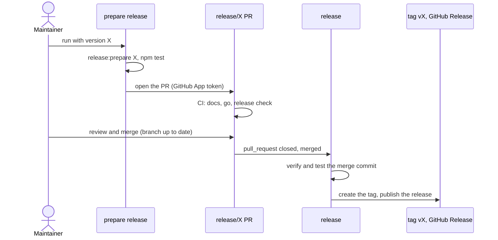
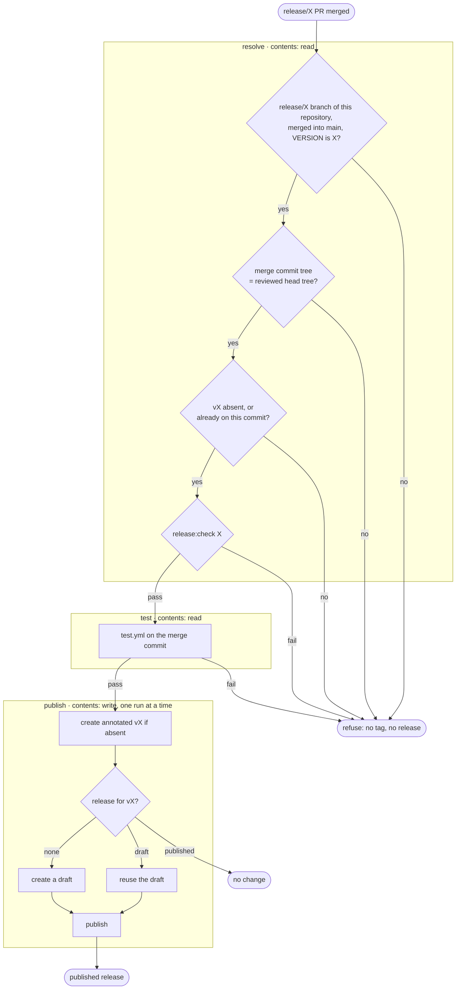

# Coral Architecture

Coral is a set of rules for organising code in a repository. Coding agents follow it, and so do people.

The organising principle is one sentence: **one trigger, one owning capability, end to end.** One command
or one endpoint is answered by one unit. That unit owns the whole of answering it. Every unit of code has
one of five known roles.

The same shape applies to a CLI, a backend, a web app, a library, or a tool. It composes from a single
capability up to a whole system.

**That core is small. It governs ownership rather than layout.** The **production baseline** holds
everything else:

- code grouped by what it does rather than by what kind of code it is
- the capability's files sitting together instead of spread across `handlers/`, `services/` and
  `repositories/`
- tests beside the code they verify
- no `utils` bucket
- crosscuts injected rather than reached for
- error-model enforcement, plus a recommended error-category vocabulary
- transaction and retry policy
- no shared database between apps

Coral publishes the production baseline as one coherent opinion. A project adopts it explicitly. Using
Coral does not inherit it.

**📖 Live docs:** https://coral.appsandtools.work

The site holds the guided version. It includes a worked directory layout, the five kinds of code, and
where the architecture does not fit.

Coral is a poor fit for dense domains where every feature reaches into one central concept: a tax engine,
a scheduler, a solver. `[SCOPE-2]` states that limit as a rule.

## What Coral claims, and how it is judged

Coral's claim is that its conventions let a coding agent implement, change, and replace features with less
human implementation work, while a human keeps architectural control. The conventions separate **stable
behavior contracts** from **replaceable implementations**. A behavior contract is what callers and tests
depend on, and it changes only deliberately. The implementation behind it can be changed or rewritten by
an agent without the contract moving. The human decides where the contracts and the boundaries are. The
agent does the implementation work inside them.

**Three things are not goals for `1.0.0`:** a Coral-specific linter, a multi-agent harness, and a
conformance score used as a quality measure. Obedience to the rules is not the claim, and a count of
satisfied rules does not measure whether the claim holds.

**Coral is validated by use on real projects first.** Building and changing an application with the rule
set, and acting on what that use finds, comes before any other evidence. A controlled comparison against
other architectures is deferred. No empirical validation exists yet, and nothing in these documents
reports one.

**The claim is testable, and any of these counts against it:**

- an agent repeatedly misreads a rule
- escalations to the human are mostly avoidable
- a replacement breaks a behavior contract
- human implementation work stays necessary

## The documents

Start with [`CONVENTIONS.md`](./CONVENTIONS.md). It defines the eight nouns every other document uses, the
rule-ID scheme, the enforcement classes, and the agents-write / humans-review operating model. It defines
two further things the other documents depend on:

- the [Coral kernel](./CONVENTIONS.md#the-coral-kernel): the rules Coral would substantially relax without
  the agent-author / human-architect operating model
- [what applies to a project](./CONVENTIONS.md#what-applies-to-a-project): how a project declares how much
  of Coral it has taken on

The rest refer back to it instead of restating any of it.

From there, in the order a project decides things:

1. [`ARCHITECTURE.md`](./ARCHITECTURE.md): the kernel-facing app architecture. It gives the shape of one
   app, and the rules whose presence or strictness Coral justifies by its operating model. It binds a
   Coral codebase without being adopted. It is short.
2. [`PRODUCTION.md`](./PRODUCTION.md): the **production baseline** for one app, and the decision whether
   to take it. It covers package naming, buckets, state ownership, concurrency, idempotency, errors,
   config, observability, contracts, trust, testing, growth, and code comments. It is **the recommended
   default for an application**, and it stays optional. Coral publishes it as an opinionated
   production-engineering policy, and it applies only where a project's `CORAL.md` says
   `production-baseline: true`. Its justification is that the software needs it, not that an agent
   wrote it.
3. [`SYSTEM.md`](./SYSTEM.md): how separately-built apps compose over a channel. It is optional as well.
   It carries two independent opt-ins: the system-scale production baseline, and the runtime-agent
   orchestration rules. Neither implies the other.
4. [`appendix/`](./appendix): one document per **app profile** (CLI, backend, web, library, GitHub
   Action). It also holds the runtime-agent addendum an app of any shape adds when it calls a model at
   runtime. Each is adopted by name.

[`examples/`](./examples) holds worked code: two CLI slices in Python,
[`examples/cli-slice.md`](./examples/cli-slice.md), and an executable Go project,
[`examples/go-api-slice/`](./examples/go-api-slice), whose page excerpts the code. The directory also
holds [a real service reviewed against the rules](./examples/backend-review.md); that review states
where the rules would have been overkill.

[`guides/`](./guides) holds protocols. They define no rule.
[Deciding and escalating](./guides/deciding-and-escalating.md) sorts an agent's implementation decisions
into the ones it makes alone, the ones it verifies first, and the ones a human makes.
[Behavioral verification](./guides/behavioral-verification.md) states how a project writes an
acceptance criterion and how it changes expected behavior.

[`rules.md`](./rules.md) lists every rule on one page, grouped by document. Each entry carries its class,
its ownership layer, its scale, and a one-line statement. Use it to look a rule up rather than to read for
it. `npm run rules:index` generates the page from the documents, and the build fails if the page falls
behind them. An index that can drift from what it indexes is worse than no index.

**Only a small part of Coral is imposed because an agent writes the code.** That subset is the
[kernel](./CONVENTIONS.md#the-coral-kernel): a small set of rules, named and justified one at a time, and
counted in [`rules.md`](./rules.md)'s layer tally. Coral publishes general production-engineering policy
separately, as the production baseline and the app profiles. A project adopts that policy rather than
inheriting it. The build enforces the separation structurally: it
rejects an opt-in rule defined in a [core document](./CONVENTIONS.md#core-documents).

Rules carry stable IDs like `[DUP-2]`, and three independent classifications:

- an **[enforcement class](./CONVENTIONS.md#enforcement-classes)** saying whether the rule is decidable
  by deterministic analysis in principle (`[auto]`), needs judgment (`[review]`), or is rationale rather
  than a gate (`[guide]`)
- an **[ownership layer](./CONVENTIONS.md#ownership-layers)** saying who has to read it, so a CLI is not
  asked to reason about HTTP status codes or runtime-AI rules
- an **[architectural scale](./CONVENTIONS.md#architectural-scale)** saying whether it governs one app or
  several apps composing

A rule binds whether or not anything verifies it yet:
[rules define conformance, and verification is separate and partial](./CONVENTIONS.md#rules-and-verification).

On the live site every citation links to its definition. The build fails on any of the following:

- a rule has no class or no layer
- a citation has no definition
- a rule is missing from its document's Agent Execution Contract
- a contract lists an opt-in rule without saying so
- an opt-in rule is defined in a core document
- a published rule ID has disappeared or been reclassified
- the rule index is stale
- a `CORAL.md` in this repository stops resolving: the worked example in `CONVENTIONS.md`, the template
  in `templates/`, or the example project's record in `examples/go-api-slice/`
- the example project's committed `CORAL-CONTRACT.md` differs from what the generator writes
- a link fragment does not resolve

The documents' drift control is structural, not goodwill.

## Start a project

The recommended configuration is the kernel, the production baseline, and one app profile. Kernel-only
is the exception, not the default. [`templates/CORAL.md`](./templates/CORAL.md) records that
configuration for a backend app: `scales: [app]`, `production-baseline: true`, `app-profile: [backend]`,
no exceptions, no extensions.

Setup also depends on one skill outside this repository: the `doc-maintenance` skill from
[haddock](https://github.com/throw-if-null/haddock/tree/v0.5.0), at tag `v0.5.0`. The skill is the
procedure an agent follows for code comments and documentation. It defines no Coral rule. Each Coral
release pins one haddock tag. The dependency first ships in `0.8.0`.

A project pins a Coral **release**. Each release is an annotated tag, `v<version>`, on a commit of
`main`, published as a [GitHub Release](https://github.com/throw-if-null/coral/releases) whose notes
state the rules it adds, tightens, loosens, or retires and what a project must now satisfy. The rule
documents, the generator, and the agent protocols of one release all come from that tag. `main` moves,
so nothing a project depends on is read from it.

1. Select a release from the Releases page. Copy the template to the project root as `CORAL.md`. Set the
   project name in the heading. Set `targets` to the release's version, such as `"0.11.0"`.
2. Obtain the source of that release, and install the generator's one dependency:

   ```bash
   git clone --depth 1 --branch v0.11.0 https://github.com/throw-if-null/coral.git coral-0.11.0
   cd coral-0.11.0
   npm ci --omit=dev
   ```

   The release's source archive, listed on its GitHub Release, holds the same files. The Coral checkout
   is a tool for generation and verification. It is not a runtime dependency of the project. Do not add
   it as a submodule, vendor it, or install it as a package.
3. From that checkout, generate the execution contract, and commit `CORAL-CONTRACT.md` in the project:

   ```bash
   npm run contract:generate -- --project /path/to/project
   ```

   The contract is a committed architectural artifact: it records which rules govern the project, at
   which version. The generator refuses a `CORAL.md` whose `targets` differs from the checkout's version,
   and names the version it expects. The generator first ships in `0.7.0`. A project that targets an
   earlier version has no generator to run.
   [Versioning](#versioning-and-how-a-project-records-where-it-differs) describes the generator and its
   output.
4. Verify the committed contract in CI. The job reads `targets` from `CORAL.md`, checks out that release,
   and fails when the generator output differs from the committed file:

   ```yaml
   coral-contract:
     runs-on: ubuntu-latest
     steps:
       - uses: actions/checkout@v7
       - name: Read the pinned Coral version
         id: coral
         run: echo "version=$(sed -n 's/^targets: *"\{0,1\}\([0-9.]*\)"\{0,1\} *$/\1/p' CORAL.md)" >>"$GITHUB_OUTPUT"
       - uses: actions/checkout@v7
         with:
           repository: throw-if-null/coral
           ref: v${{ steps.coral.outputs.version }}
           path: .coral
       - uses: actions/setup-node@v7
         with:
           node-version-file: .coral/.node-version
       - run: npm ci --omit=dev --prefix .coral
       - name: Check CORAL-CONTRACT.md against the pinned release
         run: node .coral/scripts/generate-contract.mjs --project . --stdout | diff -u CORAL-CONTRACT.md -
   ```

5. Add an agent instructions file, `CLAUDE.md` or `AGENTS.md`, to the project root. It tells the agent
   to load the generated contract, the decision protocol, and the
   [behavioral verification protocol](./guides/behavioral-verification.md) from the tag of the pinned
   Coral release, and `doc-maintenance` at the pinned haddock tag. When the project moves `targets`,
   change the Coral tag in these URLs to the same release:

   ```markdown
   ## Coral

   Load `CORAL-CONTRACT.md` before you change code. It holds every `[auto]` and `[review]` Coral
   rule that applies to this project, plus the project's accepted exceptions and extensions. It is
   generated. Do not edit it.

   Load the decision protocol,
   <https://raw.githubusercontent.com/throw-if-null/coral/v0.11.0/guides/deciding-and-escalating.md>,
   before you change code. It is the protocol for which decisions are yours, which you verify first,
   and which a human makes. It defines no rule.

   Load the behavioral verification protocol,
   <https://raw.githubusercontent.com/throw-if-null/coral/v0.11.0/guides/behavioral-verification.md>,
   before you write or change a test. It states how an acceptance criterion is written and how
   expected behavior changes. It defines no rule.

   Load the haddock `doc-maintenance` skill,
   <https://raw.githubusercontent.com/throw-if-null/haddock/v0.5.0/skills/doc-maintenance/SKILL.md>,
   before you change code or documentation. It is the procedure for code comments and
   documentation. It defines no rule.
   ```

   Claude Code can also install the skill as a plugin, pinned to the same tag:

   ```bash
   claude plugin marketplace add throw-if-null/haddock#v0.5.0
   claude plugin install haddock@throw-if-null
   ```

   `#v0.5.0` pins the marketplace to the tag. Without it, the marketplace follows haddock's default
   branch, and a plugin update can install a different version of the skill. When a settings file
   already declares the `throw-if-null` marketplace under `extraKnownMarketplaces` without the tag, the
   first command fails with `Cannot add marketplace "throw-if-null": its source doesn't match its
   extraKnownMarketplaces entry in user or managed settings; add it from the source that entry lists, or
   change the entry.` Set `ref` to `v0.5.0` in the `source` of that entry, and run the command again.
   The plugin also installs a `SessionStart` hook that adds haddock's primer to each session. Keep the
   snippet line in the instructions file, so that an agent without the plugin loads the same version.
6. Run the conflict check before the agent changes code, and again each time the project changes
   `targets`. Ask the agent to do these steps:

   1. Read every instruction source that the agent loads in this project:
      - user-global instruction files
      - repository instruction files: `CLAUDE.md`, `AGENTS.md`, `CLAUDE.local.md`, and the equivalent
        files of other agents
      - hooks that inject instructions
   2. Compare each source with `CORAL-CONTRACT.md`, the two protocols, and `doc-maintenance`.
   3. Report each conflict: the source, its conflicting passage, and the passage of the contract, a
      protocol, or `doc-maintenance` that it conflicts with. Resolve none of them (`[AGENT-2]`).

   A human resolves each conflict. The human edits the conflicting source, or records an exception in
   `CORAL.md` (`[VER-5]`, `[AGENT-4]`) when the project deviates on purpose. An exception names a Coral
   rule, so it resolves only a conflict with a rule in `CORAL-CONTRACT.md`.

Three things are outside the canonical configuration:

- System scale is off: `scales: [app]` declares one deployable app, so no `SYSTEM.md` rule binds.
- The runtime-agent addendum is off: `runtime-agent-profile: false`, and an app that calls a model at
  runtime sets it to `true`.
- The other app profiles, `cli`, `web`, `library`, and `gh-action`, are not chosen; an app of another
  shape names its profile in `app-profile` instead of `backend`.

## Versioning, and how a project records where it differs

Coral is versioned because it will be **incomplete**: rules get missed, patterns need covering, and some
rules turn out to be wrong. [`CHANGELOG.md`](./CHANGELOG.md) records what changed, per rule ID. Rule IDs
are append-only. They are never renumbered, recycled, or removed. `rules.lock` is the checked-in record
the build enforces that against.

**Coral carries two versions, and the difference matters because `[VER-3]` makes version identity part
of applicability.** The **latest released** version is in `VERSION`: the latest cut version. A project
pins a version that has a published GitHub Release ([Releasing Coral](#releasing-coral)). The **working** version is the rule set these documents currently describe: the version the
changelog's `## Unreleased` heading names, or `VERSION` when the heading names none. When the heading
names a version, it is a successor to `VERSION`, and **`main` describes rules that are not in any release
yet**. A project that generates its contract from `main` targets the working version, and the generator
refuses any other target.
[`CONVENTIONS.md`](./CONVENTIONS.md#two-versions-released-and-working) states the split.

A consuming project keeps a **`CORAL.md`** in its root. It is the one file that answers *what rules apply
here*, and it carries three things:

- the **Coral version** the project targets (`[VER-3]`)
- **what it adopts** (`[VER-6]`): the scales it is written at, and the non-kernel scopes it takes on
- two kinds of local divergence, each scoped to a path:
  - an **Exception**: Coral has a rule, and this project knowingly breaks it for a trade-off, in one
    subtree
  - an **Extension**: Coral has no rule, this project needs one, and it stays local under its own ID
    prefix

The kernel applies without being declared. Everything else, the production baseline included, applies
because the adoption block says so. **A rule never becomes applicable by existing in this repository.**
Adding a profile or a rule here changes nothing for a project until that project adopts it. A missing or
invalid declaration is a configuration finding, not a licence to audit against everything.

Coral layers **compose by union**, with no precedence between them. No layer overrides another. Two Coral
rules that contradict each other are a defect in Coral. File it upstream rather than resolving it locally.

A third kind of divergence is not recorded locally. An **Amendment** applies when a Coral rule is *wrong
or too narrow*, and it goes upstream as an issue or PR on this repository. An exception that recurs across
projects is the signal for one. When the amendment lands, the project deletes the local entries and bumps
its target. **The register shrinks when Coral improves.**

An agent never authors an exception or an extension (`[AGENT-4]`). It flags the ambiguity, and a human
decides and records it. An agent reads `CORAL.md` before escalating (`[AGENT-5]`), so a settled decision
is not reopened by every agent that meets it.
[`CONVENTIONS.md`](./CONVENTIONS.md#versioning-and-local-deviations) holds the full convention.

From that declaration a project generates **`CORAL-CONTRACT.md`**. The file holds the project's complete
normative Coral surface: every applicable `[auto]` and `[review]` rule, plus its own exceptions and
extensions. An agent that loads that file knows every Coral requirement the project is answerable to
without opening a Coral document. The protocols in `guides/` define no rule, and the agent instructions
file loads them separately ([Start a project](#start-a-project)).

```bash
# from a Coral checkout describing the version the project targets
npm run contract:generate -- --project /path/to/project
```

The command lives here, in the Coral checkout. `--project` names the consuming repository, because Coral
supports projects that are not Node projects at all.

The rule model always comes from the checkout that runs the command, and no flag points it elsewhere. The
documents are only half of a release, and the code that reads them is the other half. Generating for
another Coral version therefore means checking out that version and running its own `contract:generate`.

The output is generated, never edited. `CORAL.md` stays the only file a project writes by hand. Rules from
a scale, layer or profile the project has not adopted leave no trace in the output. Output is
byte-identical for the same inputs.

An unresolvable declaration produces an error and no contract. It also leaves no *stale* contract: a
failed regeneration removes the file the previous run wrote rather than leaving a file that looks current.
The generator only ever removes or replaces files it wrote. It refuses anything else at the destination
rather than overwriting it. [`CONVENTIONS.md`](./CONVENTIONS.md#the-generated-execution-contract)
documents it.

## Releasing Coral

A release takes two maintainer decisions: which version to release and when, and whether to merge the
release PR. Merging the release PR approves publication. Ordinary merges never create a version, a tag,
or a release.

1. Merge changes into `main` through pull requests. Each one records its changes under `## Unreleased`
   in `CHANGELOG.md`. Keep the section's first paragraph a summary of the batch and its compatibility.
   It becomes the first paragraph of the release notes and the tag message.
2. Run the **prepare release** workflow with the version, from the Actions tab or with
   `gh workflow run prepare-release.yml -f version=0.12.0`. The version is the next patch, minor, or
   major version, or the version that the Unreleased heading names. A patch states that no rule changed,
   so it is refused when `rules.lock` or `rules.md` changed since the last release. The workflow opens
   the PR `Cut 0.12.0` from the branch `release/0.12.0`. The PR body states the version decision and
   the rule surface changes, followed by the release notes.
3. Review the release PR, and merge it. To correct it first, push to its branch. When `main` changes,
   the PR must be updated and pass CI again before it can merge. An update that brings changes the
   release section does not record fails CI: close the PR, delete its branch, and prepare the release
   again.
4. The **release** workflow tags the merge commit v0.12.0 and publishes the GitHub Release. The run
   summary shows the release URL.





The version terms:

- `main` is development. `## Unreleased` holds the changes that are in no release. When its heading
  names a version, that is the working version.
- `VERSION` names the latest cut version in the tree. The release PR changes it. It does not show that
  the version is published.
- The tag `v<version>` is the release source. The release workflow creates it on the release PR's merge
  commit, and nothing moves it.
- The GitHub Release publishes the version. A project pins only a version that has one.

### Recovery

- **Prepare release fails:** nothing is pushed. Fix the cause on `main` through a pull request, and run
  the workflow again. When the branch was pushed but no PR was opened, delete the branch, and run again.
  For an open release PR, a second run reports the PR and changes nothing.
- **The release workflow fails after the merge:** nothing is tagged until the checks pass. Re-run the
  failed jobs. Publication resumes from the tag or the draft that an earlier attempt created, and a
  published release is left unchanged. When the run is too old to re-run, run the workflow for the same
  release PR: `gh workflow run release.yml -f pr=<number>`. It accepts only a merged release PR.
- **The merged release commit fails its checks or is refused:** it is not published, and no other
  commit can take its version. Fix `main`, and release the next version.

### One-time repository setup

Code cannot enforce these. A maintainer applies them once.

1. **GitHub App.** The prepare release workflow opens the PR with an installation token, because a PR
   that the default `GITHUB_TOKEN` opens starts no `pull_request` workflow, and the release PR would get
   no CI. Create an App without a webhook, with the repository permissions **Contents: read and write**
   and **Pull requests: read and write**, and install it on this repository only. Store its client ID as
   the repository variable `RELEASE_APP_CLIENT_ID`, and a private key as the repository secret
   `RELEASE_APP_PRIVATE_KEY`. The App needs no bypass of any ruleset.
2. **Required checks on `main`.** Add a `required_status_checks` rule to the `main` ruleset: the checks
   `docs` and `go` from GitHub Actions, and "require branches to be up to date". A PR then merges only
   when both checks passed on its latest revision, and only when it contains the latest `main`. The
   up-to-date requirement applies to every PR into `main`. Without it, a release PR that lags `main`
   can merge, and the release workflow refuses to publish it.

   The command keeps the ruleset's existing rules and adds this one:

   ```bash
   gh api repos/throw-if-null/coral/rulesets/22379989 |
     jq '{rules: (.rules + [{type: "required_status_checks", parameters: {
           strict_required_status_checks_policy: true, do_not_enforce_on_create: false,
           required_status_checks: [{context: "docs", integration_id: 15368},
                                    {context: "go", integration_id: 15368}]}}])}' |
     gh api -X PUT repos/throw-if-null/coral/rulesets/22379989 --input -
   ```

3. **Immutable releases:** a published release and its tag cannot change.
   `gh api -X PUT repos/throw-if-null/coral/immutable-releases`
4. **A tag ruleset for `refs/tags/v*`** with the rules `update` and `deletion`, and no bypass actors. Do
   not restrict creation: the release workflow creates the tags.

## The audit skill

[`.claude/skills/coral-audit/`](./.claude/skills/coral-audit) is the operational counterpart to the docs.
Point it at a repo and it produces a `CORAL_AUDIT.md`. The report answers one question: *is this a Coral
app, and where does it diverge?* Structural divergences are the findings. Bugs the audit surfaces are
recorded as awareness notes, never the verdict. The skill diagnoses only. A human decides the refactor
approach later, in a separate planning session.

Claude Code loads the skill when you work in this repo, because it lives in `.claude/skills/`. Auditing
*other* repos is the intended use. Install it at user level:

```bash
ln -s "$PWD/.claude/skills/coral-audit" ~/.claude/skills/coral-audit
```

Use a symlink rather than a copy. Two copies of the same rules drift, and the docs are the one place the
rules are allowed to live.

## Run the docs locally

```bash
npm install
npm run docs:dev      # live preview at http://localhost:5173
npm run docs:build    # static site → .vitepress/dist
npm run docs:preview  # serve the built site
```

GitHub Actions runs `npm test`, which is `npm run docs:build`, and the Go example's build and tests in
`examples/go-api-slice/` on every pull request and push to `main`.

## Deployment

**Cloudflare Workers Static Assets** hosts the site at
[coral.appsandtools.work](https://coral.appsandtools.work). The deployment is static only. `wrangler.jsonc`
declares no `main` entrypoint and no `run_worker_first`, so Cloudflare's asset server serves every request
rather than a Worker invocation. That keeps the site inside the Free plan, and it adds no KV, R2, D1, or
Durable Objects.

Deployment runs through **Cloudflare Workers Builds**, Cloudflare's own GitHub integration, rather than
through GitHub Actions. A push to `main` triggers a build. The build runs `npm run build`, which is the
full pipeline including the version, rule, and anchor checks. It then runs `npx wrangler deploy`, which
publishes `.vitepress/dist`. Cloudflare authenticates the repository through the GitHub App, so **no
Cloudflare API token or account ID belongs in this repository**.

`.node-version` pins the Node major used by local builds, by the CI `docs` job, and by Cloudflare builds.
A change to Cloudflare's default Node version therefore cannot silently change the build. `npm audit`
reports advisories against
Vite 5 and esbuild, which concern the dev server only and are accepted until VitePress 2 is stable, and
against KaTeX, which is accepted until a `vitepress-plugin-mermaid` release allows mermaid 12.
`.github/dependabot.yml` keeps mermaid on 11 for that reason.

### One-time Cloudflare setup

Do this once, in the Cloudflare dashboard.

**Workers Builds**, in Workers & Pages → `coral` → Settings → Build:

| Setting | Value |
| --- | --- |
| Repository | `throw-if-null/coral` |
| Production branch | `main` |
| Build command | `npm run build` |
| Deploy command | `npx wrangler deploy` |
| Non-production branch builds | enabled (gives every branch and PR a preview URL) |

Preview builds use Cloudflare's own preview deployment mechanism. `wrangler.jsonc` sets `preview_urls` to
`true`, so branch builds get a versioned preview URL even though `workers_dev` is off. The account needs a
`workers.dev` subdomain for those preview URLs to resolve.

**Custom domain**, in Workers & Pages → `coral` → Settings → Domains & Routes:

- add `coral.appsandtools.work` as a **custom domain** (not a route)
- `appsandtools.work` must already be a zone on the same Cloudflare account
- Cloudflare then creates and manages the DNS record and the TLS certificate

`wrangler.jsonc` already declares the custom domain, so `npx wrangler deploy` claims it on the first
deploy. Add it in the dashboard only if that step is skipped.

## License

Coral is released under the MIT License; see [`LICENSE`](./LICENSE).
